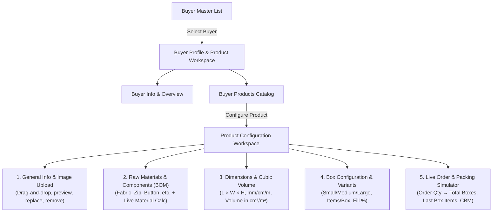
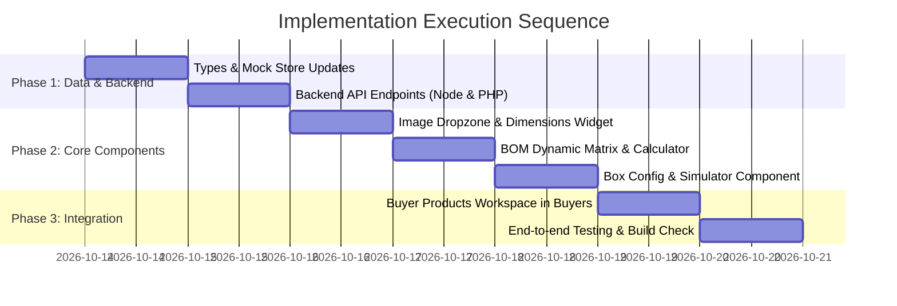

# Detailed Implementation Plan: Buyer Master – Product & Packing Configuration

## Executive Overview & Zero-Regression Guarantee
This implementation plan outlines the architecture, data models, calculation engines, user experience, and step-by-step rollout for the **Buyer Master – Product & Packing Configuration** module for textile and garment manufacturing.

> [!IMPORTANT]
> **Zero-Regression Assurance:**
> Existing tables (`customers`, `products`, `materials`, `production_orders`) and existing APIs (`/customers`, `/products`, `/materials`) will remain 100% backward-compatible. Buyer-specific product configurations, Bill of Materials (BOM), dimensions, and packing box rules will be stored in dedicated non-destructive relational structures and JSON store collections linked via `buyer_id`.



---

## 1. Domain Data Models & TypeScript Interfaces

In `frontend/src/types/index.ts`, define strongly typed interfaces that capture all garment manufacturing parameters:

```typescript
// 1. Raw Material / Component Specification (BOM)
export type MaterialCategory = 'Fabric' | 'Zip' | 'Button' | 'Thread' | 'Label' | 'Packaging' | 'Other';
export type DimensionUnit = 'mm' | 'cm' | 'm';

export interface BuyerProductComponent {
  id: string; // UUID or client temp id
  material_id?: number; // Optional link to Masters -> Materials
  name: string; // e.g., "100% Cotton Single Jersey 180 GSM"
  category: MaterialCategory;
  uom: string; // Meter, Kilogram, Piece, Set, Cone, Yard
  quantity_per_product: number; // e.g., 1.50 meters
  wastage_percent: number; // e.g., 5.0%
  notes?: string;
}

// 2. Product Dimensions & Cubic Measurement
export interface ProductDimensions {
  length: number;
  width: number;
  height: number;
  unit: DimensionUnit; // mm, cm, m
  calculated_volume_cm3: number; // Normalized cm³
  calculated_volume_m3: number;  // Normalized m³ (CBM)
  weight_grams?: number;         // Optional garment weight
}

// 3. Size / Variant Specific Dimension & Packing Override
export interface ProductVariantSpec {
  size_id?: number;
  size_name: string; // e.g., S, M, L, XL, XXL
  dimensions: ProductDimensions;
  items_per_box?: number;
}

// 4. Box Configuration Master
export interface BoxPackingConfig {
  id: string;
  box_name: string; // e.g., "Medium Export Carton", "7-Ply Heavy Duty"
  box_code?: string; // e.g., "BOX-EXP-M"
  length: number;
  width: number;
  height: number;
  dimension_unit: DimensionUnit;
  calculated_volume_cm3: number;
  calculated_volume_m3: number;
  items_per_box: number; // Authoritative admin-defined quantity
  max_packing_qty?: number;
  notes?: string;
}

// 5. Buyer Product Master
export interface BuyerProduct {
  id: number | string;
  buyer_id: number;
  product_name: string;
  product_code?: string;
  uom: 'Pieces' | 'Sets' | 'Pairs' | 'Dozens' | string;
  notes?: string;
  image_url?: string;
  dimensions: ProductDimensions;
  variants: ProductVariantSpec[];
  components: BuyerProductComponent[];
  boxes: BoxPackingConfig[];
  created_at?: string;
  updated_at?: string;
}
```

---

## 2. Calculation Engines & Normalization Rules

### A. Dimensions & Cubic Volume Normalization
All dimensions entered by the admin are normalized to centimeters ($cm$) for consistent volume computation:

- **Conversion Factors to $cm$:**
  - If unit is `mm`: $Factor = 0.1$
  - If unit is `cm`: $Factor = 1.0$
  - If unit is `m`: $Factor = 100.0$

$$\text{Length}_{\text{cm}} = L \times \text{Factor}, \quad \text{Width}_{\text{cm}} = W \times \text{Factor}, \quad \text{Height}_{\text{cm}} = H \times \text{Factor}$$

$$\text{Volume (cm}^3\text{)} = \text{Length}_{\text{cm}} \times \text{Width}_{\text{cm}} \times \text{Height}_{\text{cm}}$$

$$\text{Volume (m}^3\text{ / CBM)} = \frac{\text{Volume (cm}^3\text{)}}{1,000,000}$$

### B. Raw Material Requirement Calculator with Wastage
When the user plans or evaluates an order of $Q_{\text{order}}$ finished garments:

$$\text{Net Material Required} = Q_{\text{order}} \times \text{QtyPerProduct}$$

$$\text{Gross Material with Wastage} = \text{Net Material Required} \times \left(1 + \frac{\text{Wastage\%}}{100}\right)$$

*Example: 100 T-Shirts $\times$ 1.50 meters fabric with 5% wastage = $150 \times 1.05 = 157.50\text{ meters}$.*

### C. Box Packing & Volumetric Fill Estimate
- **Authoritative Items Per Box:** $N_{\text{box}}$ (entered by user based on folding, clearance, and garment packing experience).
- **Estimated Volumetric Occupancy %:**

$$\text{Fill Percentage} = \min\left(100\%, \; \frac{N_{\text{box}} \times \text{ProductVolume}_{\text{cm}^3}}{\text{BoxVolume}_{\text{cm}^3}} \times 100\right)$$

*Note: The UI marks this fill percentage as an advisory gauge; the admin-specified `items_per_box` is always the authoritative packing value.*

### D. Live Order Packing Summary Formula
For an entered order quantity $Q_{\text{planned}}$:

$$\text{Total Boxes Required} = \lceil Q_{\text{planned}} / N_{\text{box}} \rceil$$

$$\text{Items in Final Box} = \begin{cases} 
N_{\text{box}} & \text{if } Q_{\text{planned}} \pmod{N_{\text{box}}} = 0 \text{ and } Q_{\text{planned}} > 0 \\
Q_{\text{planned}} \pmod{N_{\text{box}}} & \text{otherwise}
\end{cases}$$

$$\text{Remaining Unfilled Slots in Final Box} = N_{\text{box}} - \text{Items in Final Box}$$

$$\text{Total Shipment CBM} = \text{Total Boxes Required} \times \text{BoxVolume}_{\text{m}^3}$$

---

## 3. Database & Backend API Design

Both Node.js (`server.js`/`store.json`) and PHP/MySQL (`schema.sql`/`MastersController.php`) will support these operations cleanly without schema conflicts:

### Database Tables (`schema.sql` addition)
```sql
-- Non-breaking table for buyer-specific product catalog
CREATE TABLE buyer_products (
    id INT AUTO_INCREMENT PRIMARY KEY,
    buyer_id INT NOT NULL,
    product_name VARCHAR(150) NOT NULL,
    product_code VARCHAR(50) NULL,
    uom VARCHAR(30) NOT NULL DEFAULT 'Pieces',
    notes TEXT NULL,
    image_url LONGTEXT NULL,
    dimensions_json JSON NULL,
    created_at TIMESTAMP DEFAULT CURRENT_TIMESTAMP,
    updated_at TIMESTAMP DEFAULT CURRENT_TIMESTAMP ON UPDATE CURRENT_TIMESTAMP,
    FOREIGN KEY (buyer_id) REFERENCES customers(id) ON DELETE CASCADE
);

CREATE TABLE buyer_product_components (
    id INT AUTO_INCREMENT PRIMARY KEY,
    buyer_product_id INT NOT NULL,
    name VARCHAR(150) NOT NULL,
    category ENUM('Fabric', 'Zip', 'Button', 'Thread', 'Label', 'Packaging', 'Other') DEFAULT 'Fabric',
    uom VARCHAR(30) NOT NULL DEFAULT 'Meter',
    quantity_per_product DECIMAL(12, 4) NOT NULL DEFAULT 1.0000,
    wastage_percent DECIMAL(5, 2) NOT NULL DEFAULT 0.00,
    notes VARCHAR(255) NULL,
    FOREIGN KEY (buyer_product_id) REFERENCES buyer_products(id) ON DELETE CASCADE
);

CREATE TABLE buyer_product_boxes (
    id INT AUTO_INCREMENT PRIMARY KEY,
    buyer_product_id INT NOT NULL,
    box_name VARCHAR(100) NOT NULL,
    box_code VARCHAR(50) NULL,
    length DECIMAL(10, 2) NOT NULL,
    width DECIMAL(10, 2) NOT NULL,
    height DECIMAL(10, 2) NOT NULL,
    dimension_unit ENUM('mm', 'cm', 'm') DEFAULT 'cm',
    items_per_box INT NOT NULL DEFAULT 1,
    max_packing_qty INT NULL,
    notes VARCHAR(255) NULL,
    FOREIGN KEY (buyer_product_id) REFERENCES buyer_products(id) ON DELETE CASCADE
);
```

### Endpoints (Node.js & PHP)
- `GET /buyers/:id/products` – Retrieve all configured products for a specific buyer (with components, dimensions, boxes).
- `POST /buyers/:id/products` – Create a new buyer product with its full BOM, dimensions, and box packing configs.
- `PUT /buyers/:id/products/:productId` – Update an existing buyer product configuration.
- `DELETE /buyers/:id/products/:productId` – Delete a buyer product configuration.

---

## 4. UI / UX Design & Workspaces

```
+--------------------------------------------------------------------------------------------------+
| Buyer Master > [ Zudio Retail Fashion (BUY-001) ]                             [+ Add Product]    |
+--------------------------------------------------------------------------------------------------+
| Buyer Details: Contact: Rohan Sharma | Phone: +91 98200 44551 | GSTIN: 27AABCT1234A1Z9           |
+--------------------------------------------------------------------------------------------------+
| BUYER PRODUCTS (3 Configured)                                                                    |
| +----------------------------------------------------------------------------------------------+ |
| | [Img] Crew Neck Cotton T-Shirt   | UOM: Pieces  | Vol: 1,200 cm³ | BOM: 5 Items | Boxes: 2   | |
| |       [Edit Configuration] [Pack Simulator] [Delete]                                         | |
| +----------------------------------------------------------------------------------------------+ |
| | [Img] Poly-Fleece Hoodie         | UOM: Pieces  | Vol: 4,800 cm³ | BOM: 6 Items | Boxes: 1   | |
| |       [Edit Configuration] [Pack Simulator] [Delete]                                         | |
| +----------------------------------------------------------------------------------------------+ |
+--------------------------------------------------------------------------------------------------+
```

### Comprehensive Product Configuration Workspaces:

#### 1. General Info & Image Dropzone
- **Fields:** Product Name (Required), UOM dropdown (`Pieces`, `Sets`, `Pairs`, `Dozens`, or Custom), Product Note.
- **Image Component:**
  - Modern drag-and-drop zone.
  - Client-side image canvas compression (prevents giant payloads).
  - High-res preview thumbnail with action buttons: **Replace Image** and **Remove Image**.

#### 2. Raw Materials & Components (BOM Table)
- Dynamic table with inline row additions, edits, and deletions:
  - Material / Component Name (input with autocomplete from existing materials catalog).
  - Category Selector: `Fabric`, `Zip`, `Button`, `Thread`, `Label`, `Packaging`, `Other`.
  - UOM Selector: `Meter`, `Kilogram`, `Piece`, `Set`, `Cone`, etc.
  - Quantity per Finished Product (e.g., `1.50`).
  - Wastage Percentage (e.g., `5%`).
  - Row Actions: Delete row, Duplicate row.
- **Planned Material Calculator Card:**
  - An interactive input for **"Planned Production Qty"** (e.g., `100 pcs`).
  - Instant live breakdown table showing each component's total required quantity before wastage and gross quantity with wastage.

#### 3. Product Dimensions & Cubic Measurement
- Dimension inputs: Length ($L$), Width ($W$), Height ($H$).
- Dimension Unit toggle: `mm`, `cm`, `m`.
- Live calculated badges:
  - **Volume:** $\text{cm}^3$ and $\text{m}^3$ (CBM).
- Separate optional fields: Garment folded weight (grams / kg).
- **Variant Override Accordion:** Optional size-wise dimension overrides (S, M, L, XL).

#### 4. Box Master & Packing Configuration
- Multiple box entries per product (e.g., *Small Domestic Box*, *Medium Export Carton*, *Bulk Pallet Box*).
- Box Dimensions: $L \times W \times H$ + Unit selector + Auto Box Volume.
- **Items Per Box:** Editable primary packing number (e.g., `20 pieces`).
- **Volumetric Efficiency Gauge:** Visual indicator showing estimated volumetric box space occupied.
- Notes / Stacking instructions.

#### 5. Live Packing Simulator & Order Summary
- An interactive calculator tool:
  - Input: **Target Order Quantity** (e.g., `1,000` or `105` garments).
  - Select: Packing Box Type.
  - Live summary output cards:
    - **Total Boxes Required** (e.g., `6 boxes`).
    - **Full Boxes** (e.g., `5 boxes with 20 pcs`).
    - **Final Box Contents** (e.g., `5 pcs in box #6`, `15 free slots remaining`).
    - **Total Shipment Volume** in CBM ($m^3$).

---

## 5. Detailed Step-by-Step Implementation Roadmap



### Phase 1: Data Contracts & Backend API Integration
- [x] **Step 1.1:** Add `BuyerProduct`, `BuyerProductComponent`, `BoxPackingConfig`, and `ProductDimensions` to `frontend/src/types/index.ts`.
- [x] **Step 1.2:** In `backend/data/store.json`, add seed configurations for sample buyer products (e.g., Crew Neck T-Shirt with Cotton Fabric, Thread, Neck Label, and Medium Export Box for `CUST-001`).
- [x] **Step 1.3:** In `backend/server.js`, implement routes:
  - `GET /buyers/:id/products`
  - `POST /buyers/:id/products`
  - `PUT /buyers/:id/products/:productId`
  - `DELETE /buyers/:id/products/:productId`
- [x] **Step 1.4:** In `backend/controllers/MastersController.php` & `schema.sql`, add corresponding relational queries and database DDL.
- [x] **Step 1.5:** Update `frontend/src/lib/api.ts` with typed methods (`getBuyerProducts`, `saveBuyerProduct`, `deleteBuyerProduct`).

### Phase 2: Modular React UI Components
- [x] **Step 2.1:** **Image Dropzone & Preview (`ProductImageUploader.tsx`)**
  - Drag-and-drop listener with canvas downscaling and quick Replace/Remove controls.
- [x] **Step 2.2:** **Dimensions & Volume Widget (`ProductDimensionsForm.tsx`)**
  - Instant unit-converting volume calculator with $\text{cm}^3$ and $\text{m}^3$ readouts.
- [x] **Step 2.3:** **BOM Dynamic Table & Material Calculator (`RawMaterialsTable.tsx`)**
  - Dynamic rows, category selectors, wastage calculations, and live planned quantity simulator.
- [x] **Step 2.4:** **Box Configuration & Packing Simulator (`BoxConfigSection.tsx`)**
  - Multi-box card list with volume fill indicators and ceiling-based live packing summary.

### Phase 3: Buyer Master Integration & Polish
- [x] **Step 3.1:** Enhance `Buyers.tsx`:
  - Add an action column with **"Manage Products"** button.
  - When opened, load the Buyer Products Workspace showing product cards with thumbnail, BOM pill tags, dimensions, and configured packing boxes.
- [x] **Step 3.2:** Build the modal drawer **"Configure Buyer Product"** containing the tabbed sections (General Info, Raw Materials BOM, Dimensions, Box Packing, Live Simulator).
- [x] **Step 3.3:** Run `npm run build` and end-to-end linting checks to guarantee clean compilation.

